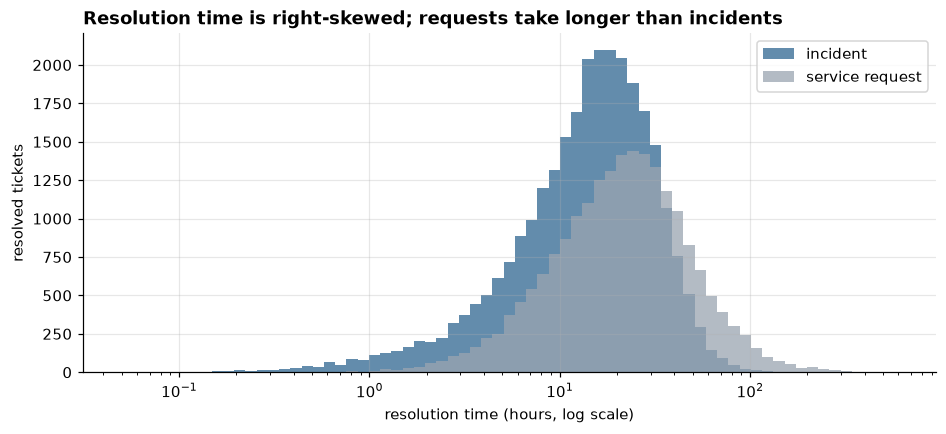
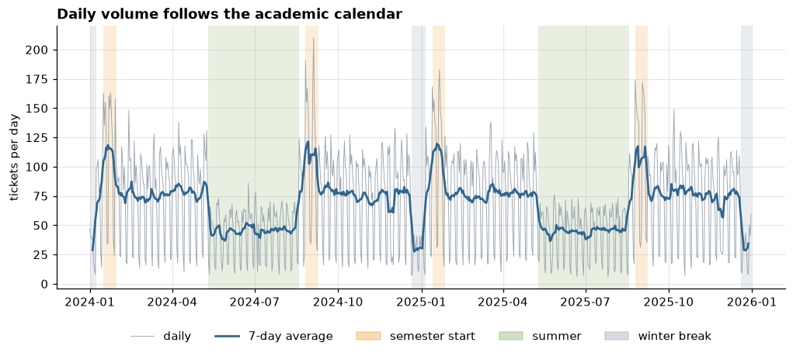
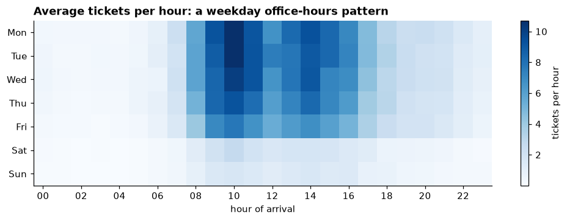
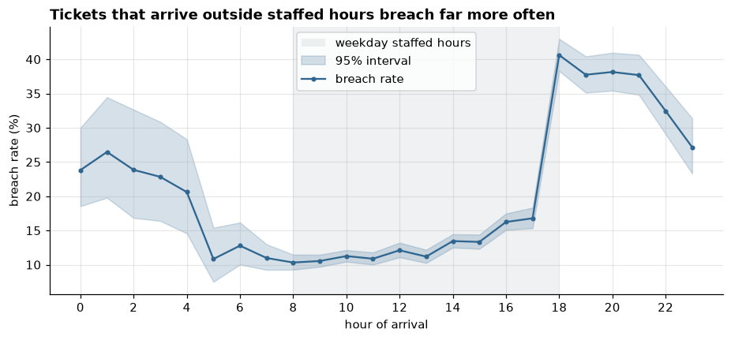
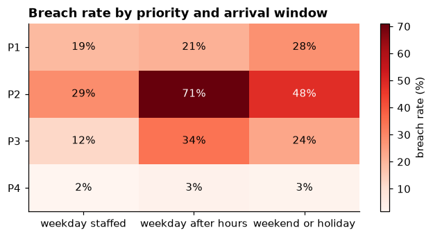
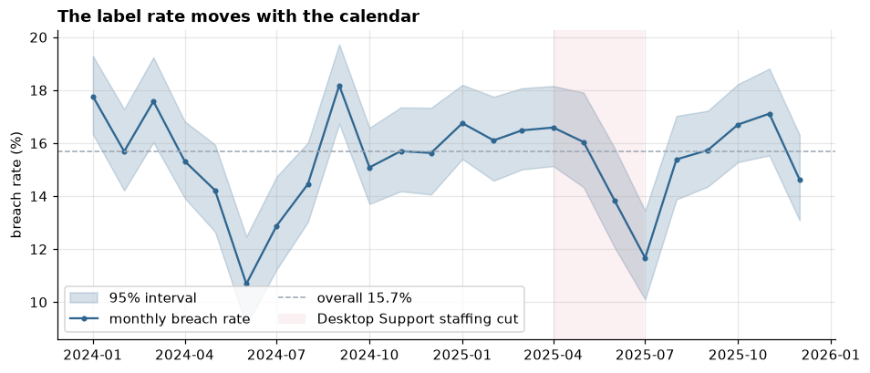
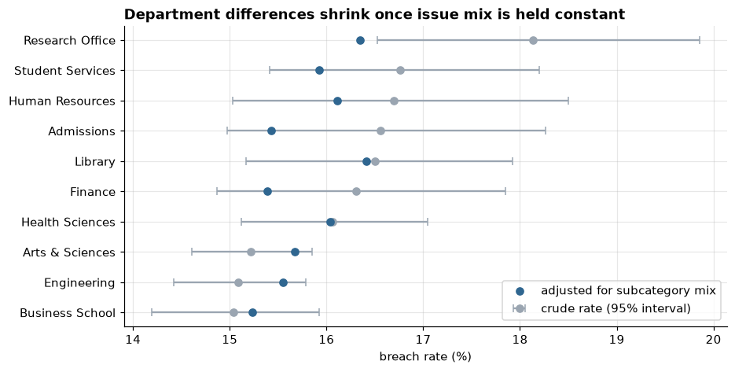
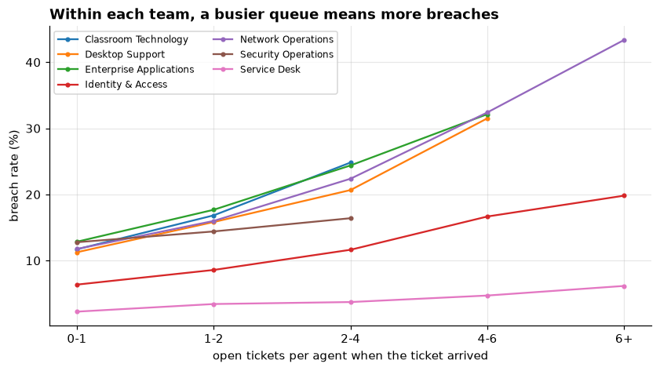
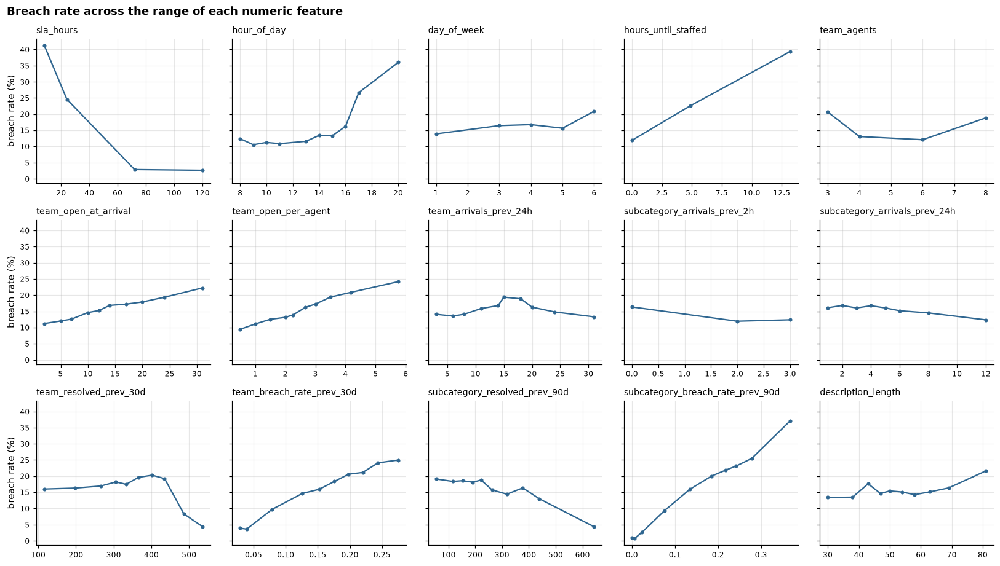
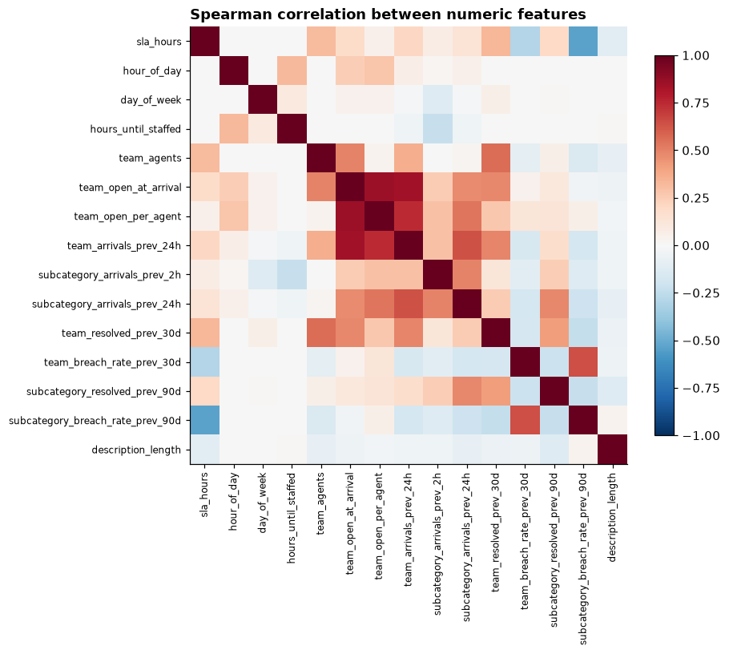

# OpsPilot AI - Exploratory Data Analysis Findings

## About this analysis

This document summarizes the exploratory analysis in two notebooks:

- [notebooks/01_eda.ipynb](../notebooks/01_eda.ipynb): data quality, distributions, time patterns, the label, confounding, interactions, and statistical significance.
- [notebooks/02_feature_assessment.ipynb](../notebooks/02_feature_assessment.ipynb): the signal in each model feature, redundancy, missing history, drift between training and test periods, and the decision record for the SLA breach model.

[sql_analysis.md](sql_analysis.md) answered business questions with SQL. This analysis asks the data science questions that come before modeling: which effects are real, which stand in for something else, which combine, and how the model should be built and judged.

The data is the synthetic dataset described in [dataset_design.md](dataset_design.md) (seed 42, 49,242 resolved tickets). Several patterns were designed into it; the analysis checks that they can be recovered and learns what a model will face. It does not describe a real organization.

To reproduce, load the database (see the README) and run both notebooks from the top. Charts are saved to [reports/figures/](../reports/figures/) and the confidence intervals to [reports/stats/](../reports/stats/). The test suite executes both notebooks, so they are known to run.

## Summary

- **Missing values are structural.** Outcomes are missing exactly for unresolved and cancelled tickets, and satisfaction for survey non-response. Nothing should be imputed.
- **When a ticket arrives matters more than almost anything else.** Breach rates are 10-17% for tickets arriving 08:00-17:00 and about 38-41% for those arriving 18:00-21:00. An after-hours P2 ticket breaches 71% of the time, against 29% during staffed hours.
- **Department is a proxy, not a cause.** Department breach rates differ by 3.1 points; holding the mix of issues constant leaves 1.2 points, within noise.
- **Urgent wording is also a proxy.** Tickets that say "urgent" breach 11.9 points more often, but within each priority the difference is 0.1 points.
- **A busier queue means more breaches inside every team,** with team-specific slopes (Network Operations: 11.8% to 43.4%).
- **At this sample size, p-values cannot rank effects.** Every variable is significant; effect sizes separate priority (Cramer's V 0.32) from department (0.02).
- **An overall metric can hide a team-level change.** The Desktop Support staffing cut is hard to see in the overall monthly breach rate.
- **The test period looks like the training period.** Base rates are 15.6% and 15.7%; only one feature drifted moderately, for a benign reason.
- **The modeling plan is fixed before training:** population, split, features, average precision as the primary metric, and baselines to beat.

## 1. Data quality

Creation-time fields have no missing values. The outcome columns (`resolved_at`, `resolution_hours`, `resolved_by_team`, `sla_breached`) are missing for 1,053 tickets, all of them unresolved or cancelled. `satisfaction_score` is missing for 71.7% of resolved tickets, because most requesters do not answer the survey. Every missing value has a reason, so none of them should be filled in with averages.

Two details matter later. A few tickets share a creation timestamp to the second (50,251 distinct values for 50,295 tickets), which is why the SQL backlog calculation needs a tie-breaker. And `description` has only 9,903 distinct values because it comes from templates, which makes text features look more useful than they would on real tickets.

## 2. Resolution time

Resolution time is strongly right-skewed (skewness 4.5; -0.78 on a log scale). Service requests take longer than incidents (median 21.5 against 15.1 hours) and have a much longer tail (99th percentile 137.6 against 60.3 hours). Medians are the right summary, and a model of resolution time would be better fitted to log hours.

## 3. Volume over time

Volume follows the academic calendar: about 45 tickets a day in summer, about 115 at semester starts, and about 30 over winter break. Within the week it peaks at 10:00 on Monday to Wednesday, at about 10 tickets an hour, and weekend volume is a small fraction of weekday volume.

## 4. When a ticket arrives

This is the strongest pattern in the data. Tickets arriving during staffed hours breach 10-17% of the time, rising through the day as queues build. At 18:00 the rate jumps to 40.6% and stays near 38% until 21:00, because those tickets wait the whole night. Tickets arriving after midnight do better (21-27%) because their wait is shorter.

The effect depends on priority. P2 tickets, with an 8-hour target, go from 29% to 71% after hours. P3 goes from 12% to 34%. P4 barely changes (2% to 3%) because its long target absorbs a night's wait. P1 changes little on weekday evenings (19% to 21%) thanks to on-call cover, but reaches 28% at weekends. This is an interaction: a model with purely additive effects cannot represent it without an explicit interaction term.

## 5. The label

15.7% of resolved tickets breached. A model that never predicts a breach would be 84.3% accurate and find none of the 7,732 breaches, so accuracy is not a useful measure here.

The monthly rate ranges from 10.7% (June 2024) to 18.2% (September 2024), lowest in summer and highest around semester starts.

The chart is also a warning. The Desktop Support staffing cut (April-June 2025, shaded) is hard to see in the overall rate, which falls through that quarter as summer begins. Only a comparison with the same months of 2024 hints at it (16.6%, 16.0% and 13.8% against 15.3%, 14.2% and 10.7%). A change in one team can hide inside an overall metric, so model performance will also be reported by team.

Of the 562 tickets created in the final 14 days, 45 had no outcome at the snapshot. They are the slow ones by definition, so the modeling data stops at 2025-12-17.

## 6. Proxies: department and urgent wording

Department breach rates range from 15.0% (Business School) to 18.1% (Research Office). Direct standardization asks what each department's rate would be with the overall mix of issues. Adjusted for subcategory mix, the spread falls from 3.1 to 1.2 points, and every department's crude interval overlaps the others.

The reason is the mix. Administrative offices submit more Software and Hardware tickets and fewer password resets than academic units, and those categories breach more. From their mix alone they would be expected to breach 16.6-17.3% of the time, against 15.3-15.5% for academic units. Department looks predictive because it stands in for what a department asks for, which is how the data was generated.

Urgent wording shows the same pattern within a single feature. Tickets that mention urgency breach 11.9 points more often overall, but only 0.1 points more within each priority. It carries no information beyond priority.

## 7. Workload within teams

The workload effect appears inside every team, not only between busy and quiet teams. Network Operations goes from 11.8% breached with under one open ticket per agent to 43.4% at six or more. The slope is steep for teams with tight incident targets and shallow for Service Desk (2.3% to 6.2%), whose work is quick with long targets. A slope that differs by team is a second interaction for the model to capture.

## 8. Significance and effect size

| Variable | Levels | p-value | Cramer's V |
|---|---|---|---|
| priority | 4 | < 1e-300 | 0.316 |
| category | 8 | < 1e-300 | 0.211 |
| assigned_team | 7 | < 1e-300 | 0.209 |
| arrival window | 3 | < 1e-300 | 0.196 |
| academic_period | 4 | 9.7e-35 | 0.057 |
| requester_type | 3 | 2.3e-14 | 0.036 |
| channel | 5 | 3.8e-10 | 0.032 |
| department | 10 | 4.5e-03 | 0.022 |

Every association is statistically significant, so p-values do not separate a strong effect from a negligible one. Cramer's V does. Taken alone, department's p-value of 0.0045 would look like a finding; section 6 shows it is mostly issue mix.

Measuring the channel association on random samples makes the point concrete. The p-value goes from 0.26 at 2,000 tickets to 4e-10 at 49,242, while Cramer's V settles near 0.03. A 500-ticket sample gave p = 0.03 and V = 0.14: a "significant" result that overstated the association several times over, because Cramer's V is biased upward in small samples.

## 9. Reproducible intervals and multiple comparisons

The confidence intervals quoted in [sql_analysis.md](sql_analysis.md) are now computed in notebook 01 with a tested helper and saved to [reports/stats/phase3_intervals.csv](../reports/stats/phase3_intervals.csv). Two results were new:

- Excluding 18-20 March, Security Operations' Q1 2025 increase is 0.6 points (-4.4 to 5.6). The phishing campaign explains all of it.
- Enterprise Applications, Q3 2025 against Q3 2024, changed by -4.9 points (-8.5 to -1.2). The interval excludes zero, but nothing changed for that team in the generator.

There are 28 year-over-year team-quarter comparisons, and at 95% confidence about 1.4 would exclude zero by chance alone. Scanning many comparisons and reporting the ones that look significant surfaces noise, which is the main reason the modeling plan in section 11 was fixed in advance.

## 10. Features for the model

**Signal on their own.** The strongest single numeric features are `sla_hours` (AUC 0.78 read in reverse: tighter targets breach more), the subcategory's recent breach rate (0.744), the team's recent breach rate (0.657), `hour_of_day` (0.625), `hours_until_staffed` (0.623) and open tickets per agent (0.597). Among categorical features, `subcategory` (Cramer's V 0.33) and `priority` (0.32) are strongest.

The count features (`team_resolved_prev_30d`, `subcategory_resolved_prev_90d`) mostly stand in for team and subcategory: their breach rate drops at the highest values, which belong to Service Desk and password resets. Single-feature AUC also misses interactions such as workload within a team.

**Redundancy.** `category` and `ticket_type` are fully determined by `subcategory`, and `team_agents` by `assigned_team`. The three backlog features are correlated at 0.75-0.85.

**Missing history.** Every missing history value is in January 2024. Starting the modeling window on 2024-02-01 removes them at the cost of 2,567 tickets.

**Drift between training and test.** Training (February 2024 to June 2025) and test (July to mid-December 2025) have breach rates of 15.6% and 15.7%; the difference is 0.1 points (-0.7 to 0.8). Every feature has a population stability index below 0.1 except the team's recent breach rate (0.163). Its mean barely changes; the index reflects the feature's clustered distribution and the extremes in the training period. Rolling-history features follow current conditions by design, so they are the first to monitor in use. The test period also has more semester-start days (13.2% against 9.1%) and no winter break.

## 11. Decisions for Phase 5

The full decision record, with reasons, is at the end of [notebook 02](../notebooks/02_feature_assessment.ipynb) and is the authoritative version. In brief:

| Decision | Choice |
|---|---|
| Population | Resolved tickets created 2024-02-01 to 2025-12-17 |
| Split | Train to 2025-06-30 (34,426 tickets); test from 2025-07-01 (11,747), used once |
| Validation | Three expanding-window folds, validating on Q4 2024, Q1 2025 and Q2 2025 |
| Features | 6 categorical and 13 numeric; fully determined fields, near-copies, department, urgent wording and text left out |
| Primary metric | Average precision; also ROC-AUC, precision, recall, F1, calibration, bootstrap intervals and results by team |
| Threshold | Chosen on validation folds; main operating point assumes the desk can review the riskiest 10% of tickets (an assumption) |
| Baselines | Never predicting a breach; the subcategory's recent breach rate alone (AUC 0.744); logistic regression |
| Models | Logistic regression, random forest, XGBoost |

## Limitations

- **Synthetic data.** Most patterns were designed into the generator; the analysis shows they can be recovered, not that they exist anywhere real.
- **Associations.** Standardization adjusts for one factor at a time. The model will account for several together, but its coefficients and importances are still associations.
- **Text.** Template descriptions make text look more informative and less varied than real tickets.
- **Survey bias.** The bias toward extreme responses cannot be measured from the responses alone; survey averages describe respondents.
- **Capacity assumption.** The 10% review capacity used to set the operating threshold is assumed, not measured.
